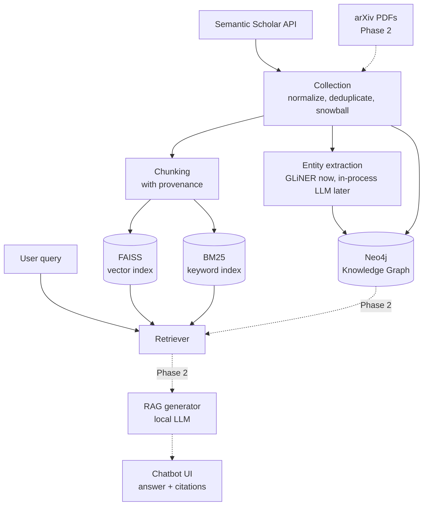

# Scientific Paper Search System (Knowledge Graph + RAG)

A system for searching, exploring, and asking questions over scientific papers. It combines a **Knowledge Graph**, **hybrid search** (keyword + vector), **Retrieval-Augmented Generation (RAG)**, and a **chatbot** to return relevant papers and answer questions with citations to the source papers.

> 🚧 **Status:** Phase 1 (Sep – Dec 2026). Requirements, architecture and the KG schema are written. The pipeline has run end to end on data version `2026-10-23`: 996 papers plus 2,096 snowballed references in KG v1, 963 chunks in the BM25 and FAISS indexes. The evaluation set is set up and waiting for hand labels. Phase 2 (next semester): RAG, chatbot, UI, and full evaluation.

---

## Table of Contents

- [Motivation](#motivation)
- [Features](#features)
- [System Architecture](#system-architecture)
- [Tech Stack](#tech-stack)
- [Project Structure](#project-structure)
- [Getting Started](#getting-started)
- [Building the Corpus](#building-the-corpus)
- [Experiments](#experiments)
- [Documentation](#documentation)
- [Roadmap](#roadmap)
- [Team](#team)

---

## Motivation

The number of scientific papers published each year is growing rapidly, and they are scattered across many databases, preprint servers, journals, and open-access archives. Finding the right paper takes more than keyword matching. Researchers also need to understand how papers, authors, topics, methods, datasets, and citations relate to one another.

This project aims to make that easier by representing academic knowledge as a graph, indexing paper content for semantic retrieval, and using an LLM to generate grounded answers that point back to their sources.

## Features

**Phase 1 — implemented**

- **Data collection:** paper metadata from Semantic Scholar for one topic (retrieval-augmented generation), normalized into one schema and deduplicated on DOI, arXiv ID, Semantic Scholar ID and title. References cited by ≥ 3 seed papers are pulled in as graph-only `:External` papers.
- **Entity extraction:** methods, datasets and research tasks from each abstract, with name normalization so surface variants (*BERT-base*, *BERT*) become one entity.
- **Knowledge Graph v1:** papers, authors, venues, topics, methods, datasets and citations in Neo4j, loaded idempotently.
- **Search baseline:** BM25 keyword search and FAISS vector search, kept separate so each can be measured alone. Every result traces back to its paper, source and character offsets.
- **Evaluation set-up:** a fixed 200-abstract corpus with tooling for judged queries and entity annotations, and the experiments that compare search models and extractors.

**Phase 2 — planned**

- **Hybrid retrieval:** fuse BM25, vector search and graph expansion.
- **RAG answering:** answers grounded in retrieved content, with citations to the source papers and sections.
- **Conversational chatbot:** follow-up questions, paper summaries, method comparisons, related-work discovery.
- **Full text:** PDF download and section splitting, so retrieval and extraction go beyond the abstract.

## System Architecture



**Pipeline overview**

1. **Collection** (`make collect`): fetch the most-cited papers on the topic from Semantic Scholar, keep English records, deduplicate, and snowball one hop of references.
2. **Extraction** (`make extract`): identify methods, datasets and research tasks in each abstract.
3. **Graph** (`make graph`): load papers, authors, venues, citations and entities into Neo4j.
4. **Indexing** (`make index`): split text into token windows with provenance, embed with `bge-small`, and build the FAISS and BM25 indexes.
5. **Retrieval:** `search_bm25` and `search_vector` return top-k chunks, each pointing to a paper and an exact span of its text.
6. **Generation** (Phase 2): a local open-weights LLM, loaded in-process, answers from the retrieved context with citations.

Every stage reads the previous stage's files and writes its own, so any stage can be re-run alone. Details: [`docs/architecture.md`](docs/architecture.md).

## Tech Stack

| Component | Technology |
|---|---|
| Language | Python 3.11 |
| Data source | Semantic Scholar API |
| Information extraction | GLiNER (KG v1); in-process open-weights LLM with `transformers` (under evaluation) |
| Graph database | Neo4j 5 (Cypher) |
| Embeddings | Sentence-Transformers, `BAAI/bge-small-en-v1.5` |
| Vector search | FAISS (exact inner product) |
| Keyword search | `rank_bm25` |
| Intermediate data | Parquet (`pyarrow`) |
| Generation (Phase 2) | Open-weights LLM loaded in-process — no API calls of any kind |

## Project Structure

```
.
├── data/
│   ├── eval/                     # Evaluation set: corpus + hand labels (tracked in git)
│   ├── raw/<version>/            # As downloaded from the sources (git-ignored)
│   └── processed/<version>/      # Normalized data, entities, chunks, indexes (git-ignored)
├── docs/                         # Requirements, architecture, decisions, KG schema, evaluation
├── notebooks/                    # Spike and experiments (not imported by the package)
│   ├── spike_data_availability.py
│   ├── collect_abstracts.py      # Builds data/eval/
│   ├── encode_specter2.py        # SPECTER2 vectors (runs in .venv-specter2)
│   ├── exp_search.py             # BM25 vs MiniLM vs bge-small vs SPECTER2
│   └── exp_extraction.py         # rules vs GLiNER vs LLM
├── scripts/
│   ├── check_neo4j.py            # Smoke test: connect to Neo4j and print its version
│   ├── collect.py                # Stage 1
│   ├── extract_entities.py       # Stage 2
│   ├── build_graph.py            # Stage 3, plus graph statistics and target queries
│   └── build_index.py            # Stage 4
├── src/
│   └── paper_search/
│       ├── config.py             # Settings loaded from .env (single `settings` object)
│       ├── models.py             # Shared types: Paper, Section, Chunk, SearchHit, PaperEntities
│       ├── collection/           # Semantic Scholar client, normalization, deduplication
│       ├── extraction/           # Entity extraction and name normalization
│       ├── graph/                # Neo4j constraints and MERGE-based loaders
│       ├── indexing/             # Chunking with provenance, FAISS and BM25 builders
│       ├── retrieval/            # search_bm25, search_vector
│       ├── rag/                  # Phase 2: prompting and answer generation
│       └── app/                  # Phase 2: API and chatbot UI
├── tests/
├── .env.example
├── docker-compose.yml            # Neo4j 5 Community + APOC
├── Makefile                      # install, neo4j-up, lint, test, and the pipeline stages
├── pyproject.toml                # Package metadata and ruff config
├── requirements.txt              # Runtime dependencies
└── requirements-dev.txt          # pytest, ruff, pre-commit, jupyter
```

## Getting Started

### Prerequisites

- Python 3.11+
- Docker (to run Neo4j via `docker-compose.yml`) — or your own Neo4j 5 instance
- A Semantic Scholar API key (optional, but strongly recommended — without one the reference lookup is heavily throttled)
- For the LLM experiments: a GPU or Apple silicon with enough free memory for a 3B model in fp16 (~6 GB). The project loads open-weights models into its own process and makes no API calls of any kind

### Installation

```bash
git clone <repository-url>
cd <repository-name>

cp .env.example .env    # then fill in NEO4J_PASSWORD and your API keys
make install            # creates .venv and installs everything (editable install)
```

`make install` builds a `.venv`, installs `requirements-dev.txt`, and installs the
project itself with `pip install -e .` so `import paper_search` works anywhere.

### Running Neo4j

`NEO4J_PASSWORD` must be set in `.env` before starting the container — Docker
Compose reads the same file the application does.

```bash
make neo4j-up       # start Neo4j 5 Community with APOC in the background
make check-neo4j    # verify the connection and print the server version
make neo4j-down     # stop it (the named volumes keep your data)
```

The Neo4j browser is then at <http://localhost:7474> and Bolt at `bolt://localhost:7687`.

### Everyday commands

| Command | What it does |
|---|---|
| `make install` | Create the venv and install runtime + dev dependencies |
| `make neo4j-up` / `make neo4j-down` | Start / stop the Neo4j container |
| `make check-neo4j` | Connect to Neo4j and print its version |
| `make lint` | `ruff check` over the repo |
| `make format` | `ruff format` plus `ruff check --fix` |
| `make test` | Run the pytest suite |
| `make pipeline` | Run all four corpus stages in order (below) |

Optionally install the git hooks so linting runs on every commit:

```bash
.venv/bin/pre-commit install
```

### Environment variables

See `.env.example` for the full list with defaults.

| Variable | Purpose | Default |
|---|---|---|
| `NEO4J_URI` | Bolt URI of the graph database | `bolt://localhost:7687` |
| `NEO4J_USER` | Neo4j username | `neo4j` |
| `NEO4J_PASSWORD` | Neo4j password (required to start the container) | *(empty)* |
| `SEMANTIC_SCHOLAR_API_KEY` | Higher rate limits on the Semantic Scholar API | *(empty)* |
| `LLM_MODEL` | Open-weights model loaded in-process; pinned once `DECIDE-7` is settled. The extraction experiment falls back to `Qwen/Qwen2.5-3B-Instruct` | *(empty)* |
| `LLM_DEVICE` | Where the model runs: `auto`, `cuda`, `mps` or `cpu` | `auto` |
| `DATA_DIR` | Where `raw/`, `processed/` and `eval/` live | `data` |

## Building the Corpus

Four stages, run in order. Each one reads the previous stage's files under
`data/processed/<version>/` and can be re-run alone. `<version>` is the collection date;
later stages pick the newest version unless given `--version`.

```bash
make collect   # ~1,000 papers + snowballed references   -> raw/<v>/, processed/<v>/papers.parquet
make extract   # methods, datasets, topics per paper        -> processed/<v>/entities.parquet
make neo4j-up
make graph     # KG v1 in Neo4j; prints node/relationship counts and runs the target queries
make index     # chunks, FAISS + BM25 indexes, manifest     -> processed/<v>/
```

Then search from Python:

```python
from paper_search.retrieval.search import search_bm25, search_vector

for hit in search_vector("dense retrieval for open-domain question answering", k=5):
    print(f"{hit.score:.3f}  {hit.chunk.paper_id}  [{hit.chunk.source}]  {hit.chunk.text[:80]}")
```

Each hit carries a `Chunk` with `paper_id`, `source` (`"Abstract"` or a section name) and
character offsets, so a citation can always be traced to the exact text it came from.

**Rate limits.** With an API key Semantic Scholar allows 1 request per second; the client
spaces requests 1.1 s apart and backs off exponentially on 429 and 5xx. Without a key the
reference lookup is throttled so hard it rarely completes. A batch that still fails is
logged and skipped, and the search result is cached in `raw/<v>/papers.jsonl` so a re-run
does not repeat it. A full collection takes about 20 requests.

## Experiments

The comparisons that decide the embedding model (`DECIDE-5`) and the extractor (`FR-9`,
`DECIDE-7`). Design and status: [`docs/evaluation.md`](docs/evaluation.md). Labelling
guide: [`data/eval/README.md`](data/eval/README.md).

```bash
.venv/bin/python notebooks/collect_abstracts.py           # 200-abstract eval corpus (done)
.venv-specter2/bin/python notebooks/encode_specter2.py    # after every edit to queries
.venv/bin/python notebooks/exp_search.py --pool           # candidates to judge
.venv/bin/python notebooks/exp_search.py                  # Recall@10, MRR@10, nDCG@10
.venv/bin/python notebooks/exp_extraction.py              # P / R / F1 per entity type
```

SPECTER2 needs `transformers < 5`, so it runs in its own venv:
`python3.11 -m venv .venv-specter2 && .venv-specter2/bin/pip install adapters torch`.

No scores are reported yet: the queries and entity annotations are written by hand.

## Documentation

| Document | Contents |
|---|---|
| [`docs/requirements.md`](docs/requirements.md) | Users, functional and non-functional requirements, use cases, scope |
| [`docs/architecture.md`](docs/architecture.md) | Pipeline, modules, interfaces, provenance, storage, failure handling |
| [`docs/decisions.md`](docs/decisions.md) | Design decisions with the rejected options and reasons ([Vietnamese copy](docs/decisions-vi.md)) |
| [`docs/kg-schema.md`](docs/kg-schema.md) | Knowledge Graph nodes, relationships, keys, target Cypher queries |
| [`docs/evaluation.md`](docs/evaluation.md) | Evaluation set and the search / extraction experiments |
| [`docs/learning-path.md`](docs/learning-path.md) | Self-study resources for the stack |

## Roadmap

The project runs over two semesters. See [Roadmap.md](Roadmap.md) for the full task list.

| Phase | Time | Focus |
|---|---|---|
| **Phase 1** (current) | Sep – Dec 2026 | Requirements, architecture, KG model, data collection, KG v1, BM25 + vector search baseline |
| **Phase 2** | Next semester | Hybrid retrieval, RAG with citations, chatbot, API and demo UI, evaluation, final thesis |

**Phase 1**
- [x] Requirements analysis and architecture design
- [x] Knowledge Graph schema
- [x] Data collection from Semantic Scholar (metadata)
- [ ] PDF text extraction and section splitting — moved to Phase 2
- [x] Entity extraction and KG v1 in Neo4j (GLiNER stand-in extractor; entity quality is weak — see [`docs/kg-schema.md`](docs/kg-schema.md) §6)
- [x] BM25 and FAISS search baseline
- [ ] Baseline evaluation (set-up done, hand labels pending) and Phase 1 report

**Phase 2**
- [ ] Hybrid retriever (keyword + vector + KG)
- [ ] RAG answer generation with citations
- [ ] Chatbot, API, and demo UI
- [ ] Evaluation, ablation, error analysis, and final thesis

## Team

| Member | Responsibilities |
|---|---|
| **Tran Ha My** | Data collection and processing (APIs, PDFs), Knowledge Graph (NER, schema, Neo4j), integration support |
| **Pham Minh Hieu** | Search module (embeddings, FAISS, BM25), RAG module, user interface |

Shared: requirements analysis, architecture design, testing, evaluation, and the final report.
