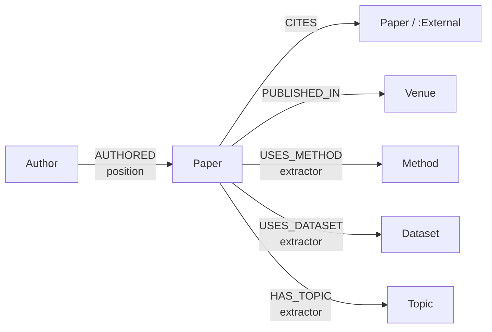

# Knowledge Graph schema

Scientific Paper Search System (Knowledge Graph + RAG) · Roadmap task 2.1

**Status:** v1, 2026-10-23 · implemented in
[`src/paper_search/graph/loader.py`](../src/paper_search/graph/loader.py), loaded by
[`scripts/build_graph.py`](../scripts/build_graph.py)

Covers `FR-11` and `FR-12`. Node and relationship types are the ones `FR-11` fixes; this
document adds properties, keys, and the queries the graph has to answer.

---

## 1. Diagram



## 2. Nodes

Every node type has exactly one uniqueness constraint, on its key. Loaders `MERGE` on
that key, so re-running a load never duplicates anything (`FR-12`).

| Label | Key (unique) | Other properties | Source |
|---|---|---|---|
| `Paper` | `paper_id` (Semantic Scholar ID) | `title`, `abstract`, `year`, `doi`, `arxiv_id`, `citation_count`, `has_full_text`, `data_version` | collection |
| `Author` | `author_id` | `name` | collection |
| `Venue` | `key` | `name` | collection |
| `Method` | `key` | `name` | extraction |
| `Dataset` | `key` | `name` | extraction |
| `Topic` | `key` | `name` | extraction |

**`:External`** is a second label on a `Paper` node, never a separate node type
(`DECIDE-1`). It marks a reference cited by ≥ 3 seed papers that was pulled in for the
graph only: no chunks, never returned by search (invariant P5). Because it is still a
`:Paper`, the `Paper.paper_id` constraint covers it — a paper first collected as a
reference and later as a seed is the same node, and the loader removes the label.

### Keys

| Node | Key | Why |
|---|---|---|
| `Paper` | Semantic Scholar ID | One ID space for seeds, references and citations. DOI and arXiv ID are kept as properties; they drive deduplication at collection (`FR-6`), not graph identity |
| `Author` | Semantic Scholar author ID, else `"name:" + lowercased name` | Names collide ("Y. Wang"). The name fallback exists only for the few authors S2 has no ID for, and can merge two people — accepted for v1 |
| `Venue` | lowercased, whitespace-collapsed venue string | S2 venue strings are already mostly canonical |
| `Method` / `Dataset` / `Topic` | `normalize_entity(name)` | See §4 |

## 3. Relationships

| Type | From → To | Properties | Notes |
|---|---|---|---|
| `AUTHORED` | `Author` → `Paper` | `position` (0 = first author) | |
| `CITES` | `Paper` → `Paper` | | Only between papers in the graph. References to anything else are dropped — the graph does not hold stub nodes |
| `PUBLISHED_IN` | `Paper` → `Venue` | | Absent when S2 has no venue |
| `USES_METHOD` | `Paper` → `Method` | `extractor` | |
| `USES_DATASET` | `Paper` → `Dataset` | `extractor` | |
| `HAS_TOPIC` | `Paper` → `Topic` | `extractor` | |

**`extractor` on every entity relationship** records which model asserted it. Extraction
is the least reliable stage and is going to be re-run when `DECIDE-7` lands; this is what
makes a rebuild traceable instead of a silent change to the graph.

**`CITES` density depends on how the seeds are chosen.** The spike sampled papers in the
API's default order and measured ~1.2 internal `CITES` per paper (constraint C2). KG v1
collects the most-cited papers first, and influential papers cite each other: §6 measures
4.3 per seed. The `:External` papers add most of the remaining citation structure.

## 4. Entities

**What counts as `Topic`.** `FR-9` extracts methods, datasets, tasks and topics, while
`FR-11` has no `Task` node. v1 stores research *tasks* ("open-domain question answering",
"fact verification") as `Topic` — they are what a user means by "papers on X". Broader
fields of study would add little: nearly every paper in a single-topic corpus would share
them.

**Normalization (`FR-10`).** `normalize_entity` lowercases, turns `- _ /` and Unicode
dashes into spaces, collapses whitespace, strips surrounding punctuation, and drops:

- a parenthesized acronym, closed or cut off by the extractor — *Retrieval-Augmented
  Generation (RAG)* and *retrieval augmented generation (rag* are one key;
- a trailing type word (`method(s)`, `approach(es)`, `technique(s)`, `task(s)`,
  `dataset(s)`) — *RAG methods* is *RAG*, *NQ dataset* is *NQ*;
- size/variant suffixes (`base`, `large`, `small`, `xl`, `uncased`, …) — *BERT-base* is
  *BERT*.

A name made only of generic words (`GENERIC` in `extraction/entities.py`: *existing
methods*, *four datasets*, *training data*, *large language models*) normalizes to `""` and
gets no node.

**Acronyms.** `acronym_aliases` reads definitions like *In-Context Learning (ICL)* off all
seed abstracts and maps the acronym key to the long-form key, so *RAG* and *ICL* join
*retrieval augmented generation* and *in context learning*. An acronym defined two ways
keeps its most frequent long form. The first surface form seen becomes `name`.

What it does **not** do: merge names whose initials do not spell the acronym (*GraphRAG*,
*Self-RAG*) or catch paraphrases (*retrieval augmentation*). Embedding-based clustering is
the next step if that fragmentation hurts the target queries.

The entity layer is derived data: `load_entities` deletes every `Method`, `Dataset` and
`Topic` node and rebuilds them, so a normalization change leaves no stale keys behind.

**Extractor in v1:** GLiNER zero-shot NER (`urchade/gliner_medium-v2.1`) on the abstract.
`FR-9` specifies an in-process LLM with schema-constrained decoding; that waits on
`DECIDE-7` and on the comparison in
[`notebooks/exp_extraction.py`](../notebooks/exp_extraction.py). GLiNER is a stand-in,
chosen because it is fast enough to run over the whole corpus on a laptop.

## 5. Target queries

The queries the graph has to answer. `scripts/build_graph.py` runs each one after loading,
with parameters picked so the result is known to be non-empty. Keep the two in sync.

**UC-2 — papers using dataset X with method Y.** The query that justifies having a graph:
no text search can answer it reliably.

```cypher
MATCH (:Dataset {key: $dataset})<-[:USES_DATASET]-(p:Paper)
      -[:USES_METHOD]->(:Method {key: $method})
WHERE NOT p:External
RETURN p.title AS title, p.year AS year ORDER BY p.citation_count DESC LIMIT 5
```

**UC-3 — a paper's neighbourhood**, grouped by how each neighbour is connected.

```cypher
MATCH (p:Paper {paper_id: $paper_id})
CALL (p) {
    MATCH (p)-[:CITES]->(o:Paper) RETURN 'cites' AS rel, o
    UNION MATCH (p)<-[:CITES]-(o:Paper) RETURN 'cited by' AS rel, o
    UNION MATCH (p)-[:USES_METHOD|USES_DATASET]->()<-[:USES_METHOD|USES_DATASET]-(o:Paper)
          WHERE NOT o:External RETURN 'shares method/dataset' AS rel, o
    UNION MATCH (p)<-[:AUTHORED]-(:Author)-[:AUTHORED]->(o:Paper)
          WHERE o <> p RETURN 'same author' AS rel, o
}
RETURN rel, count(DISTINCT o) AS papers ORDER BY rel
```

**Most-used datasets** — topic exploration (`FR` graph exploration, Phase 2 UI).

```cypher
MATCH (d:Dataset)<-[:USES_DATASET]-(p:Paper)
RETURN d.name AS dataset, count(p) AS papers ORDER BY papers DESC LIMIT 5
```

**Methods used for a topic** — the starting point for `UC-7` method comparison.

```cypher
MATCH (t:Topic {key: $topic})<-[:HAS_TOPIC]-(p:Paper)-[:USES_METHOD]->(m:Method)
RETURN m.name AS method, count(p) AS papers ORDER BY papers DESC LIMIT 5
```

Search (Phase 2 `FR-17`) must exclude `:External` papers from anything it returns as a
result: filter with `WHERE NOT p:External`, as above.

## 6. KG v1 statistics

Data version `2026-10-23`: 1,000 most-cited Semantic Scholar papers for "retrieval
augmented generation", 996 after the English filter and deduplication. Reproduce with
`make collect extract graph`.

| Nodes | Count | | Relationships | Count |
|---|---:|---|---|---:|
| `Paper` | 3,092 | | `AUTHORED` | 26,086 |
| — of which `:External` | 2,096 | | `CITES` | 22,598 |
| `Author` | 17,638 | | — seed → seed | 4,327 |
| `Venue` | 514 | | — seed → `:External` | 18,271 |
| `Method` | 1,008 | | `PUBLISHED_IN` | 3,003 |
| `Dataset` | 857 | | `USES_METHOD` | 1,359 |
| `Topic` | 867 | | `USES_DATASET` | 962 |
| | | | `HAS_TOPIC` | 1,221 |

All four target queries in §5 run and return results.

### What the numbers say

**The citation graph is denser than C2 predicted** — 4.3 internal `CITES` per seed instead
of ~1.2, because the seeds are the most-cited papers (§3). `UC-3` on the original RAG paper
finds 522 citing papers and 45 cited ones.

**The entity layer is weak, and this is the main finding for Phase 1.** The first load
(GLiNER output with string normalization only) showed three problems; the generic-phrase
filter and acronym merging in §4 fixed the first two in part:

- **Generic phrases were extracted as entities.** The five most-used "datasets" were
  *training data*, *benchmark datasets*, *documents*, *large language models* and
  *synthetic data*, so the automatic `UC-2` example was (*training data*, *retrieval
  augmented generation*). After the filter they are *HotpotQA*, *NQ*, *vector database*,
  *knowledge graphs* and *MuSiQue*, and `UC-2` picks (*graph structured data*, *retrieval
  augmented generation*), which returns two GraphRAG papers. Type errors remain
  (*vector database* is not a dataset).
- **Fragmentation.** *Retrieval-Augmented Generation*, *Retrieval-Augmented Generation
  (RAG* and *RAG* were separate `Method` nodes. Now one node holds 203 papers. Paraphrases
  still split: for the topic *question answering*, *Retrieval-Augmented Generation* (13
  papers) and *Retrieval-augmentation* (2) are still two nodes.
- **91% of Method / Dataset / Topic nodes are used by exactly one paper** — unchanged by
  the fixes — so entities connect papers far less than citations do: `UC-3` finds 3 papers
  sharing a method or dataset with the RAG paper, against 522 linked by citation.
- 71 of 996 seeds have no entity at all (58 before the filter: 13 papers had only generic
  ones).

Consequences: the extraction experiment ([`evaluation.md`](evaluation.md) §4) is what
decides whether GLiNER stays; paraphrase merging (`FR-10`) is the next fix if it does;
and until then `FR-17` graph expansion should lean on `CITES`, not on shared entities — the reverse of what architecture §6.2 assumed.
